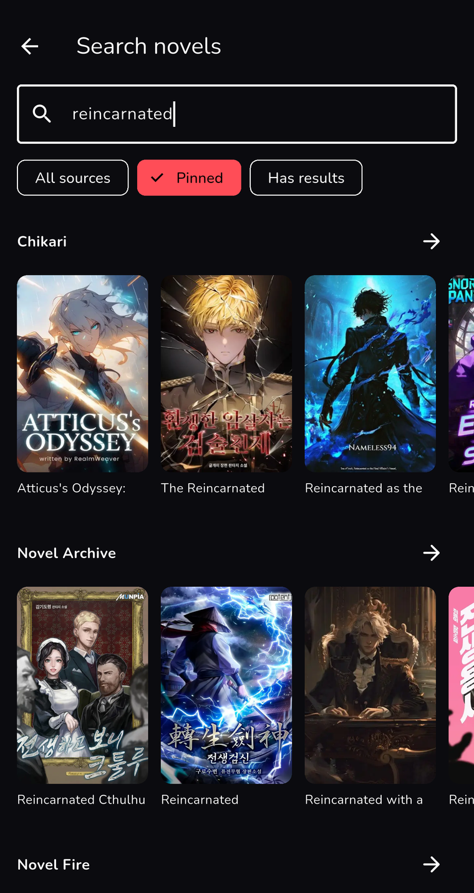
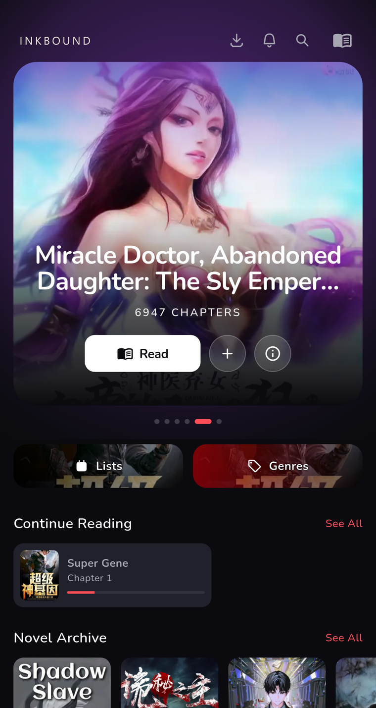
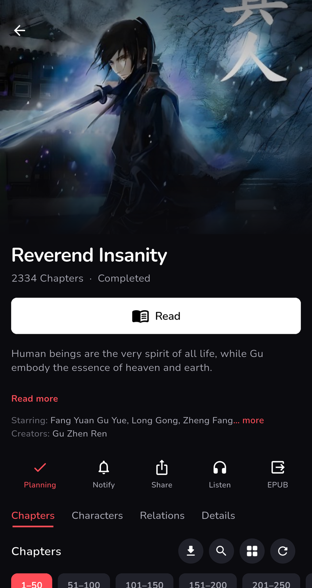
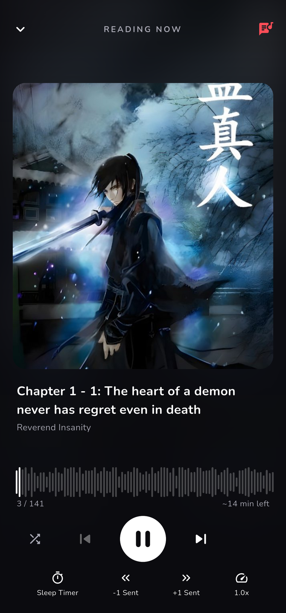
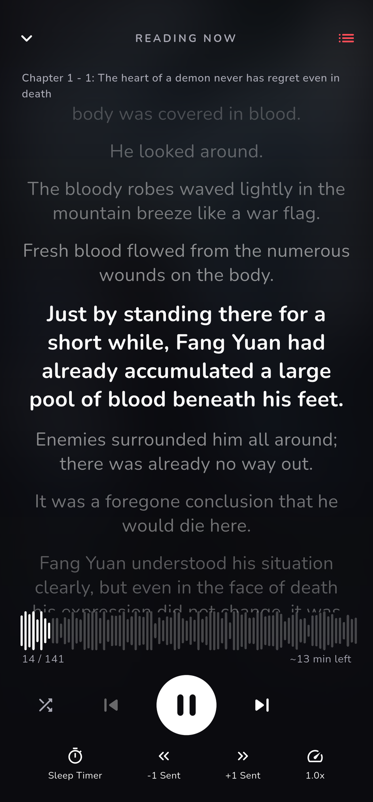

<div align="center">


# Inkbound

**Novels only. Local only. Yours.**

[](https://github.com/apauruseya786er/Inkbound/releases/latest)
[](LICENSE)

### [⬇️ Download the latest APK](https://github.com/apauruseya7866er/Inkbound/releases/latest)

Android **7.0 (API 24)**+ · **76.3 MB** · **arm64-v8a / armeabi-v7a**

</div>

<p align="center">
  
  
  
</p>

<p align="center">
  
  
</p>

---

## The day the website goes away

Every novel you save lives on someone else's server. The website isn't a detail attached to the book — as far as your library is concerned, it *is* the book. Sites get taken down. Scrapers rot. Extensions get pulled. One day a source simply stops answering, and the books on it don't fall out of your list. They're still there, still in your history, still showing their covers — and they don't open.

Most readers treat that as weather.

**Inkbound is built for the day after.** When a source dies, your books come with you: each saved novel re-pointed at a source that still answers, your position carried across, and the choice of where it lands left to you. No account to lose, no server to log into, nothing watching which books you open.

That's the whole idea. Everything below is either that idea, or the reading experience that made it worth protecting.

---

## When a source dies, your books don't

Two ways out, because you arrive at this problem knowing two different things.

**One book at a time.** Every saved novel gets a picker. Inkbound asks every installed source, ranks what comes back on a normalised title, and hands you the candidates rather than deciding for you — naming both where a book came from and where it would go. Two sites carrying the same title are two different translations, and only you know which one you were reading.

**A whole source at once.** Pick the dead source once, then place everything on it in a single pass. Narrowing once also makes the batch coherent: every book lands where you put it, rather than wherever a forty-source sweep happened to rank it.

The details that make it trustworthy:

- **Your position comes with you.** Reading position is keyed to the source it came from, so a naive migration strands it. The mover carries it, deliberately narrowly — only the furthest position, and only onto a chapter the destination actually has.
- **A wrong guess fails small.** Chapter numbering disagrees between sites, so the number is the only portable key. Inkbound resolves to the nearest chapter *at or below* your position: overshooting drops you into unread text you can't tell happened, undershooting costs you one chapter you can see.
- **Nothing is deleted.** Not the old position, not the old listing. A wrong guess costs a chapter, and everything stays put in case you migrate back.
- **It tells you what didn't move.** A batch names the books still sitting on the dead source instead of quietly dropping them — a book vanishing from a migration reads as data loss, and it should.

---

## Nothing leaves your phone

There is no account to create, no sign-in, and no server that learns what you read.

There is also **no analytics, no crash reporting, and no push notifications** — those Firebase SDKs were removed outright, not switched off. A reading app that tells its author which books you open, which sentences you rewind, and which crashes you hit is a different product than the one you think you installed.

Your library, your history and your position stay on the device. Backups are a plain JSON file written to any folder you choose — one you can open and read without this app, and another app can read too.

**The complete list of network activity:** the source sites you browse through the plugins you installed; the plugin index on GitHub plus any repositories you add; update checks and fonts, from infrastructure this repository controls; and an external solver, only if you configure one, off by default. That is all of it.

---

## The reading

This part is upstream's, and it is the reason the rest is worth doing.

**A reader built for long chapters.** Continuous scroll or page-by-page, with font, size, line height, letter and word spacing, alignment, and themes that stay dark when the system flips to dark.

**Read-aloud that sounds like a person.** Full-sentence highlighting, voice, speed, pitch, a sleep timer, and a sentence-gap control so narration sounds like speech instead of a machine enumerating clauses. It continues with the screen off, resumes from the sentence you left rather than the chapter, and stops when you swipe the app away.

**An audiobook player, and a transcript to read along to.** Tap the read-aloud bar to open it: cover, a waveform that maps the chapter, transport that skips chapters, sleep timer, speed presets. Switch to the transcript and the sentence being spoken sits centre stage, lit against the rest — tap any line to send the voice there.

**Text cleanup that follows through.** Built-in rules strip donation pleas, Discord and Patreon links, chapter footers and translator notes — including the obfuscated `P@treon` spellings and the pleas aimed at the author rather than the reader. Long-press any sentence to hide it everywhere, including in narration, so the narrator never reads an advertisement aloud.

**Progress written before the system can kill you.** The position is persisted per book *before* the app can be taken down. Close it, swipe it away, come back tomorrow: it reopens on the line you left.

**Search every source at once.** One title, queried across every installed source, grouped by where each answer came from — so the same book on two sites reads as two different translations rather than one ambiguous row. Sources are asked five at a time and rows stream in as they answer.

---

## Sources

Inkbound ships **no content and no sources of its own.** It loads community scrapers from the [LNReader](https://github.com/LNReader/lnreader-sources) ecosystem, served through [apauruseya786er/plugins](https://github.com/apauruseya786er/plugins) — a fork that tracks upstream and is where this project's scraper fixes get published. First launch seeds the index, about 290 sources today. The Sources screen takes more repositories by URL.

**Source health, because scrapers die too.** Each installed source reports whether it's working, and the health screen separates two failures that look identical and are not:

- **Dead** — blocked, timed out, or throwing. Worth nothing until the site changes.
- **No results** — answered, and the answer was nothing. For a niche title this is often a perfectly healthy site that simply doesn't carry that book.

Lumping them together quietly argues for deleting working extensions. Keeping them apart means you only ever remove what is genuinely broken. A blocked source also stops masquerading as "no matches" — a Cloudflare refusal used to be indistinguishable from an empty shelf.

**Cloudflare, in four escalating steps,** each running only if the last one failed:

1. **Native TLS stack** — fetches use Android's HTTP stack for a browser-like fingerprint.
2. **One shared cookie jar** for the reader, the source system and the solver, so a clearance can't be shadowed by a stale copy.
3. **Automatic solve** in a hidden WebView, replaying with the same User-Agent the request will send. If it needs a human, the app offers a visible one.
4. **An external solver**, if you want one — point it at a self-hosted [Solverr](https://github.com/unseensnick/Solverr), Byparr or FlareSolverr.

Sites on Cloudflare's strictest tier can't be solved by any in-app trick. Step 4 exists for those.

---

## Inkbound and Zangetsu

Inkbound is a fork of **[Zangetsu](https://github.com/Spyou/Zangetsu)** by Krishna Vishwakarma — the reader, the source system, downloads, trackers and the entire read-aloud engine are his work, carried over intact, along with most of the commit history. If Inkbound is useful to you, [starring the original](https://github.com/Spyou/Zangetsu) is the right thing to do.

They are not competing apps. They answer different questions.

| | **Zangetsu** | **Inkbound** |
|---|---|---|
| Media | Anime · Manga · Novels | **Novels only** |
| Accounts | Sign-in, cloud sync, Watch Together | **None — there is no account** |
| Telemetry | Firebase Analytics, Crashlytics, FCM | **Those SDKs removed outright** |
| When a source dies | Books stop opening | **Books migrate to a source that answers** |
| Second screen | Cast + remote control | Removed |
| Source index | Upstream LNReader | Its own, upstream-tracked, fixes published |
| Cloudflare | WebView solver | Native TLS → auto-solve → optional external proxy |

**If you read anime and manga and want cross-device sync, Zangetsu is the better app and you should use Zangetsu.** It is bigger on purpose.

Inkbound exists for the reader who reads one thing, wants it kept on their own phone, and has watched a library go stale before. Smaller APK, fewer moving parts, no sign-up, and an answer for the day a source disappears.

---

## Install

1. Download the APK from the [releases page](https://github.com/apauruseya7866er/Inkbound/releases/latest).
2. Open it on your phone and allow installs from your browser or file manager if Android asks.
3. On first launch the app seeds a source index, so you have a catalogue immediately.

**Verify the download (optional).** Releases are signed. The signing certificate's SHA-256 fingerprint is:

```
831ef2fefd7021f36f1be3e2d767aa0dcb960c1b9519346bc04413c3e564c0c8
```

> **Signing gotcha.** If you install a release build and later build from source without `android/key.properties`, you get a *debug-signed* APK, and Android will refuse to upgrade across that boundary. Uninstall before switching — and know that uninstalling deletes the library with it. This is the one place where "local only" costs you something.

---

## Build from source

You need the [Flutter SDK](https://docs.flutter.dev/get-started/install) (Dart 3.11.5 or later) and an Android toolchain.

```bash
git clone https://github.com/apauruseya7866er/Inkbound.git
cd Inkbound

flutter pub get
flutter run                  # debug build on a connected device
flutter build apk --release  # → build/app/outputs/flutter-apk/
```

Signing lives in `android/key.properties`, deliberately not in the repository; `android/key.properties.example` shows the shape. Release builds package **arm64-v8a and armeabi-v7a only** — an x86_64 emulator can't run them, and [CONTRIBUTING.md](CONTRIBUTING.md) has the opt-in that adds the emulator ABIs.

**Stack:** Flutter and Dart, [Hive](https://pub.dev/packages/hive) for local storage, Kotlin `MethodChannel`s for the TTS engine and the JavaScript source runtime, and storage access. LNReader plugins run in a JavaScript runtime; the Android side is Kotlin.

See [CONTRIBUTING.md](CONTRIBUTING.md) for CI, tests and how to open a pull request.

---

## FAQ

**A source shows an empty list.**
It's probably behind Cloudflare, or the scraper is out of date. Try the visible solve, check for an updated source, or open an issue on the [plugins repo](https://github.com/apauruseya786er/plugins).

**The app won't update over my existing install.**
See the signing note under [Install](#install).

**Why did the 3.0.x releases disappear?**
They were withdrawn when 4.0.0 shipped so the releases page would carry one clear entry. Nothing was lost: every build this project has ever published — *including the one that was withdrawn for opening every chapter as a blank page* — is written up honestly in **[CHANGELOG.md](CHANGELOG.md)**. That entry explains what was ruled out and what never was. If you only read one file to judge this project by, read that one.

---

## Credits

Inkbound would not exist without **[Zangetsu](https://github.com/Spyou/Zangetsu)** by [Krishna Vishwakarma](https://github.com/Spyou) — the reader, source system, downloads, trackers and read-aloud engine are his, and the GPL-3.0 requires that this fork say so plainly rather than quietly absorb it. Source plugins come from the [LNReader](https://github.com/LNReader/lnreader-sources) ecosystem. Contributors are in [CONTRIBUTORS.md](CONTRIBUTORS.md); third-party notices in [NOTICE.md](NOTICE.md). The full list of what this fork changes is in [FORK.md](FORK.md).

## Disclaimer

**Inkbound is a reading tool only.** It does not host, provide, distribute or maintain any content or source extension. You are solely responsible for how you use the app and for any third-party source you install, including compliance with applicable law and copyright. The maintainers disclaim all liability for misuse or legal issues arising from the app or any third-party service. This project is not affiliated with or endorsed by the authors of any source extension, or by the Zangetsu project beyond the fork relationship described above.

## License

[GNU GPL-3.0](LICENSE). Copyright © 2026 Krishna Vishwakarma (original Zangetsu project). Modifications and the novel-only reworking © 2026 apauruseya786er. Attribution requirements are in [NOTICE.md](NOTICE.md), contribution terms in [CLA.md](CLA.md), and the [AI usage policy](AI_POLICY.md) applies to this codebase.

<div align="center">

[🐛 Report an issue](https://github.com/apauruseya7866er/Inkbound/issues) · [📦 Releases](https://github.com/apauruseya7866er/Inkbound/releases) · [🔌 Plugin index](https://github.com/apauruseya786er/plugins) · [⭐ Star Zangetsu](https://github.com/Spyou/Zangetsu)

</div>